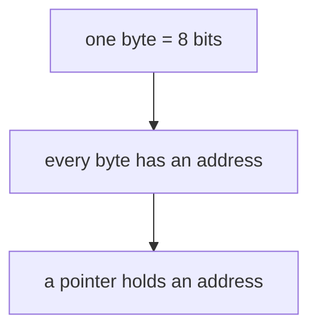

# Records — what a session leaves behind

Chat disappears. Three kinds of file carry the learning across sessions. Write them **during** the session, not from memory at the end.

```text
<topic>/
  notes.html          the note: the explanation, the learner reads it again later
  answers/
    notes.md          what the learner typed in the note's quizzes (raw, written by the page)
  knowledge.md        the knowledge record's index: one row per strand, open wrong ideas
  knowledge/
    memory.md         the claims and chains of one strand
    ownership.md
  sessions/
    2026-10-30-teach-pointers.md      one log per session
    2026-11-02-practice-pointers.md
  progress.md         optional, for a long course: words known, lessons, what is next
```

Two kinds of evidence, never mixed up:

- **Session logs** record what the learner actually answered, how sure they were, and what they thought. Use them to reason about the learner's understanding.
- **The knowledge record** is a map of what was *taught*. It is not a score. A claim in the record does not prove the learner understood or kept it; a missing claim does not prove they don't know it.

Both are written by a model and can be wrong. Ground every judgement about the learner in dated evidence from the logs, not in one answer turned into a permanent label.

## Answers typed in a note — `answers/<note>.md`

The learner answers a note's quizzes by typing in the page (`skills/notes/SKILL.md`, Quiz). Under `bun run dev` the page writes `answers/<note>.md` itself; otherwise the learner pastes the same text into the chat, and you save it to that path. It is raw input, not a record: it holds each question, the chosen option or written answer, the reasoning and the time, and nothing about right or wrong. Note answers carry no confidence number.

When the learner says "check my answers":

1. Read `answers/<note>.md` and the key of each question (`<template class="key">` in the note).
2. Go through the answers in the chat, one question at a time or in small groups. Read each one with the confidence × verdict table (`questions.md`), taking the confidence from the reasoning: a firm reason counts as sure, a hedge ("maybe", "I think") or a guess as unsure. When it matters and the reasoning does not show it, ask. For an open question, judge the reasoning against the key's model answer and its wrong ideas; a language slip is not a concept slip.
3. Write the session log (below), with each answer copied word for word from the file.
4. Write the result into the note under each graded question (`skills/notes/SKILL.md`), then update the knowledge record (its strand files, then the index).

Leave `answers/<note>.md` as it is after grading. It is the learner's original input, and the note and the log point to it.

## The session log — `sessions/YYYY-MM-DD-<kind>-<slug>.md`

`<kind>` is `teach` or `practice`. A teach session's probe goes in the same log.

````markdown
# Teach: pointers — 2026-10-30

Goal: explain why `b = a` never copies a list.

## Probe summary

| Strand | Floor (shown right) | Ceiling (wrong or unknown) | Wrong ideas found | Build from |
|---|---|---|---|---|
| Memory | knows a byte is 8 bits | cannot say what an address is | — | bytes in a row |

## Plan



Changes during the session: added `address` as a root (probe Q3 showed it was missing).

## Questions

### Q4 · check · node `pointer`

What does `b = a` copy?
A. the list · **B. the pointer** (correct) · C. the first item · D. nothing

- Picked: B · confidence: 60%
- Reasoning (their words): "names are like labels so it should copy the label"
- Verdict: right, unsure. The "label" picture is close but not the same; one more check from a new angle.

## Unsure

- [x] Is `sys.getrefcount(None)` fixed since 3.12? Checked: yes, `None` is immortal. Source: PEP 683.

## Outcome

- Claims taught: `name-holds-pointer`, `list-stores-pointers`.
- Wrong ideas still open: none.
- Ready for practice: `name-holds-pointer`.
````

Rules:

- Copy the learner's reasoning **word for word**. Do not fix their English; it is evidence.
- Every question gets its type (`probe`, `predict`, `check`, `practice`) and its node or claim id.
- A practice log also holds each problem's model solution, written **before** the problem is posed (see the practice skill).

## The knowledge record — `knowledge.md` and `knowledge/`

One per topic. It holds **claims** (single statements, each with a stable id) and **chains** (premises that *together* imply a conclusion). Claims are finer than plan nodes: a node usually yields one to three claims.

A long course collects hundreds of claims, too many to read at the start of every session. So the record has two parts:

- **`knowledge/<strand>.md`** holds the claims and chains of one strand: one area of the topic, such as memory, ownership or lists. The strands are the ones the probe uses.
- **`knowledge.md`** is the index: one row per strand, and the wrong ideas that are still open. It stays short.

```markdown
# Strand: memory

Bits and bytes, addresses, pointers, and how Python names and lists use pointers.

## Claims

| id | Claim | Taught | Last evidence |
|---|---|---|---|
| byte-256 | One byte holds one of 256 values, 0 to 255. | 01, 2026-10-30 | check ✓ 90% (2026-10-30) |
| name-holds-pointer | A Python name holds a pointer to an object, not the object. | 01, 2026-10-30 | practice recall ✗ (2026-11-02) |

## Chains

- `name-holds-pointer` + `assign-copies-name` ⇒ `alias-shares-object` — why `b = a` then `b.append(1)` changes `a`.
```

```markdown
# Knowledge record: Rust course

What was taught, not what is mastered. Evidence is in sessions/.

## Strands

| Strand | File | Claims | Weak last time | Last practice |
|---|---|---|---|---|
| Memory: bytes, addresses, pointers | `knowledge/memory.md` | 14 | `name-holds-pointer` | 2026-11-02 |
| Ownership | `knowledge/ownership.md` | 9 | — | — |

## Wrong ideas

- "`b = a` copies the list" (`assign-copies-name`). Found 2026-10-30, teach-pointers. Retest open.
```

Rules:

- **Ids are permanent.** Lowercase, digits and hyphens. Never rename one; if a claim was wrong, mark it `(withdrawn: reason)` and add a new id.
- **Ids are unique in the whole topic**, not only in their strand, so a chain can use claims from any strand. Before you add an id, search for it in `knowledge/`.
- **Taught** is the lesson or session where the claim was taught. **Last evidence** is a short pointer to the latest dated result in a session log — a summary for choosing practice targets, never a replacement for the log.
- Add claims and chains at the end of each teaching session, for what was actually taught, not what the plan intended.
- **Record what was taught, not every fact of the area.** A topic like Python lists has hundreds of facts; the record holds the claims a lesson taught and later chains need.
- **A chain goes in the strand of the session that taught it**, even when its premises come from other strands. Write each chain on one line, so a search shows all of it.
- **A new area gets a new strand file.** Split a strand when it grows past about 60 claims. Name it by area, not by lesson number. A claim keeps its id when it moves.
- **Keep the index true.** After you change a strand file, update its row: the claim count, the weak claims (✗, or right but unsure, last time) and the last practice date. Remove a wrong idea from the index once a later session shows it repaired; the session logs keep the history.

Reading the record:

- The probe and the practice skill read the index first, then open only the strand files the session needs.
- To check one claim or a few, search instead of reading whole files. Each claim is one table row:
  - one claim: `grep -rn '^| pointer-def ' <topic>/knowledge/`
  - the chains that use it: ``grep -rn '`pointer-def`' <topic>/knowledge/``
  - wrong last time: `grep -rn '✗' <topic>/knowledge/`
  - never tested: `grep -rn '| — |$' <topic>/knowledge/`
